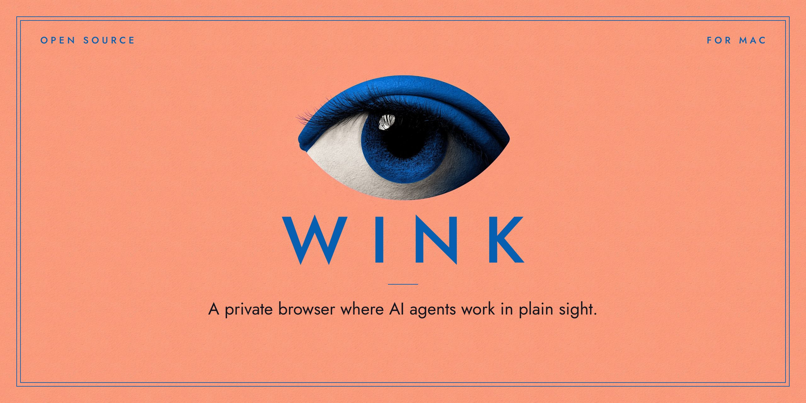
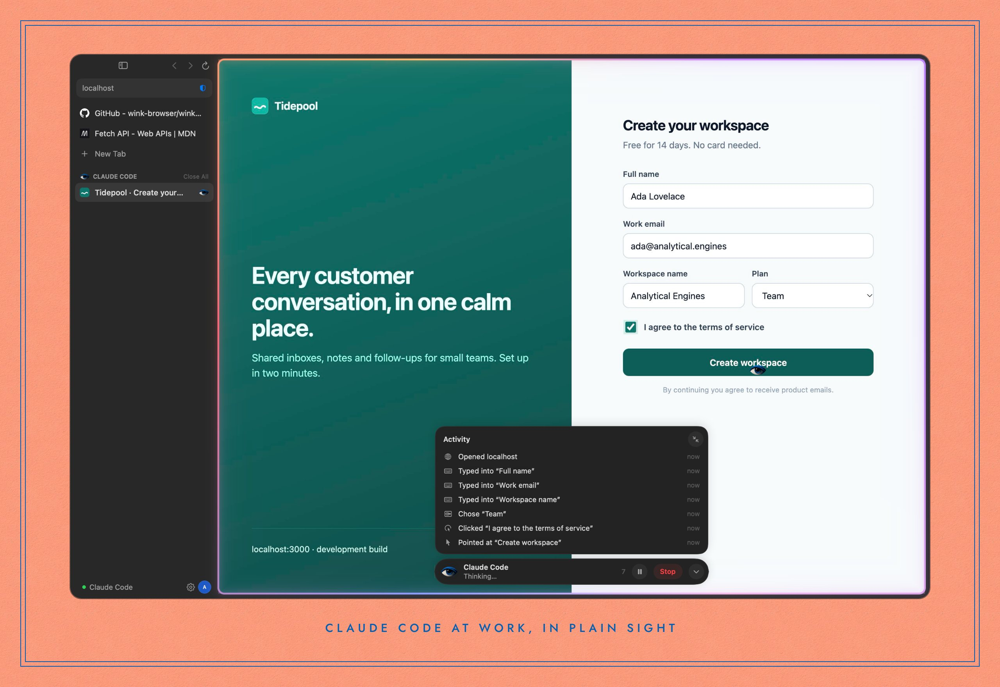
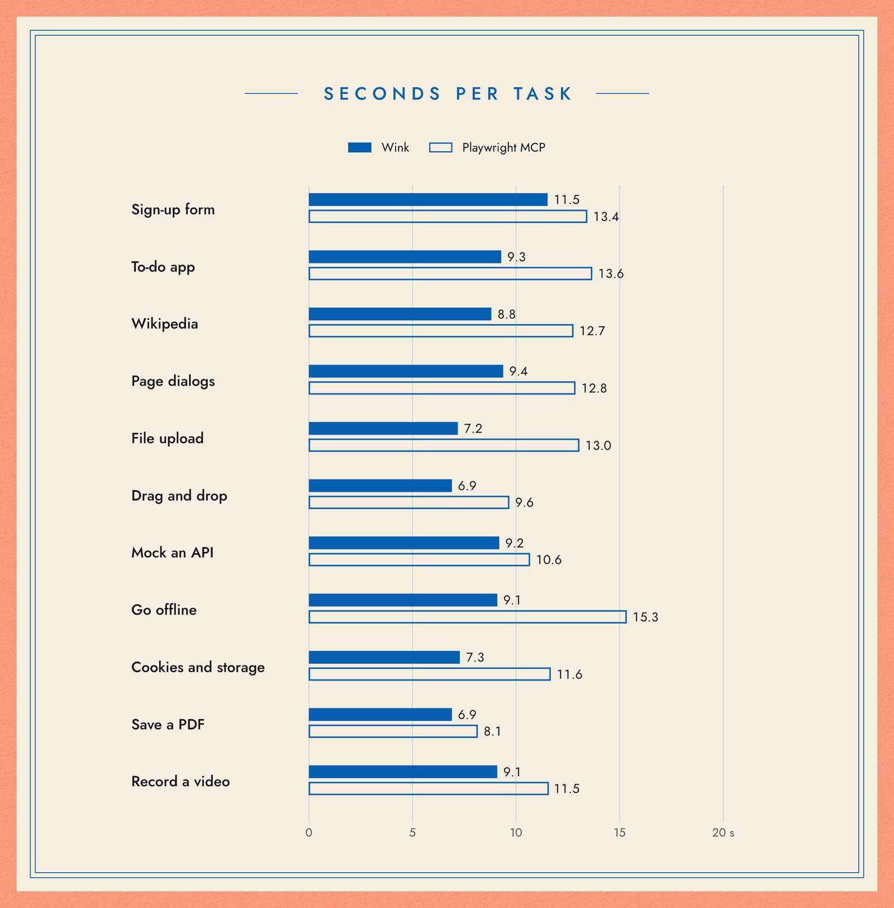
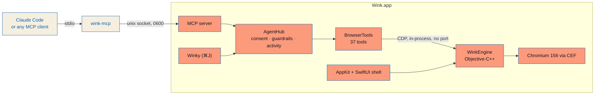

<p align="center">
  <a href="https://wink.minnebo.ai"></a>
</p>

<p align="center">
  <b>A private, agentic web browser for macOS, built on Chromium.</b><br>
  Give Claude Code a real browser, and watch it work.
</p>

<p align="center">
  <a href="https://github.com/wink-browser/releases/releases/latest"></a>
  <a href="https://github.com/wink-browser/wink/actions/workflows/ci.yml"></a>
  <a href="LICENSE"></a>
  
  <a href="docs/AGENTS.md#tools"></a>
  
</p>

<p align="center">
  <a href="https://wink.minnebo.ai/download"><b>Download for Mac</b></a>
  &nbsp;·&nbsp;
  <a href="https://wink.minnebo.ai">Website</a>
  &nbsp;·&nbsp;
  <a href="https://wink.minnebo.ai/vs-playwright">Wink vs Playwright</a>
  &nbsp;·&nbsp;
  <a href="docs/AGENTS.md">Agent docs</a>
  &nbsp;·&nbsp;
  <a href="CONTRIBUTING.md">Contribute</a>
</p>

<br>

<p align="center">
  
</p>

Wink is a native Mac browser (AppKit and SwiftUI) on the Chromium engine. Agents are first-class: a built-in [MCP](https://modelcontextprotocol.io) server lets Claude Code, or any MCP client, browse with Wink, in fewer steps than Playwright. You see every step, and Wink asks before anything consequential.

## Why Wink

<table>
  <tr>
    <td width="33%" valign="top">
      <h3>Built for agents</h3>
      Every action reports only what it changed, refs survive re-renders, and <code>batch</code> does a whole task in one call. Agents need fewer turns and tokens than with Playwright MCP.
    </td>
    <td width="33%" valign="top">
      <h3>In plain sight</h3>
      A soft aurora rims the page, Wink's eye glides to each step, and an activity log offers Pause and Stop. Wink asks before an agent sends, buys, deletes or connects.
    </td>
    <td width="33%" valign="top">
      <h3>Private by default</h3>
      93k tracker and ad domains blocked, HTTPS upgrades, no third-party cookies, Global Privacy Control. No account, no debugging port, the Chromium sandbox on.
    </td>
  </tr>
</table>

## Quick start

**1. Install.** [Download Wink](https://wink.minnebo.ai/download) (signed and notarized), drag it to Applications and open it once. If [Claude Code](https://claude.com/claude-code) is on your Mac, Wink adds itself to Claude Code's MCP servers. Nothing opens until an agent uses a tool; then Wink opens by itself.

**2. Ask.** In any Claude Code session:

> Open localhost:3000 in Wink, sign up with a test account, and tell me what errors show up in the console.

The first time, Wink asks whether to let Claude Code browse.

**3. Go headless (optional).** For parallel sessions or CI, give each agent a private, invisible, throwaway Wink:

```sh
claude mcp add --scope user wink-headless -- /Applications/Wink.app/Contents/MacOS/wink-mcp --headless
```

<details>
<summary>Adding Wink by hand, or to another MCP client</summary>

<br>

```sh
claude mcp add --scope user wink -- /Applications/Wink.app/Contents/MacOS/wink-mcp
```

Any client that speaks MCP over stdio works the same way:

```json
{ "mcpServers": { "wink": { "command": "/Applications/Wink.app/Contents/MacOS/wink-mcp" } } }
```

To stop Wink adding itself, turn it off in **Settings › Agents** or run `claude mcp remove wink`; it won't add itself again.

</details>

## Wink vs Playwright

Same agent, same prompts, both browsers headless and private. Claude Sonnet 5.5 ran eleven browser tasks three times in each. Wink 0.8.1 was against Playwright MCP 0.0.85, with Playwright's network, storage, PDF and DevTools options turned on.

| | Tool calls | Time | Input tokens | Tasks done |
|---|:---:|:---:|:---:|:---:|
| **Wink** | **21% fewer** | **28% less** | **46% fewer** | 33 / 33 |
| Playwright MCP | | | | 33 / 33 |

Wink was faster on each of the eleven tasks and never needed more steps. Two more comparisons:

- **Real websites:** on six public sites (Sauce Demo, The Internet, TodoMVC, Hacker News, GitHub, MDN), Wink needed 16% fewer steps and 30% fewer tokens with Sonnet, and 56% fewer steps and 53% fewer tokens with Haiku.
- **Many at once:** eight scripted sessions side by side finished about 3× faster, using 31% less memory.

<p align="center">
  <a href="https://wink.minnebo.ai/vs-playwright"></a>
</p>

**When Playwright is still the tool:** Wink runs on Macs, on Chromium. For test suites on Linux or Windows servers, in Firefox's and Safari's own engines, or headless by the hundred on a server farm, use Playwright. Wink's `export_test` writes the Playwright tests those servers run, so you can use both. Full method and every number: [wink.minnebo.ai/vs-playwright](https://wink.minnebo.ai/vs-playwright).

## What agents can do

Each of the 37 tools is built to save a model turn. `find` returns just the matching controls in milliseconds. Each action replies with what changed: dialogs that opened, controls that changed state, text that updated. `batch` runs up to 40 steps across page loads, by CSS selector, visible text or field label.

| | Tools |
|---|---|
| **Tabs** | `tabs_list` `get_active_tab` `tab_open` `tab_close` `tab_focus` |
| **Navigate** | `navigate` `go_back` `go_forward` `reload` `wait_for` |
| **Look** | `find` `snapshot` `read_page` `screenshot` `get_selection` |
| **Act** | `click` `type` `fill_form` `select_option` `press_key` `hover` `scroll` `drag` `upload_file` `handle_dialog` `batch` |
| **Develop** | `console_logs` `network_requests` `evaluate` `emulate` `mock_network` `storage` |
| **Keep** | `verify` `export_test` `trace` `record` `save_pdf` |

Web developers get a workbench on `localhost`: requests in full with headers and bodies, mocks and offline mode, cookies and storage, phone sizes and dark mode, and JavaScript without prompts. `export_test` turns an agent's exploration into a Playwright test, and Wink's own CI runs those tests in Chromium, Firefox and WebKit. Details in [docs/AGENTS.md](docs/AGENTS.md).

## You stay in charge

- **You see it.** A thin aurora rims the page an agent is using, Wink's eye moves to each target and winks on every click, and the activity pill lists every step.
- **You can stop it.** Pause or Stop in the pill, <kbd>⇧⌘.</kbd> stops every agent, and clicking into an agent's page pauses it.
- **It asks first.** Before an agent sends, buys, deletes, uploads or connects, Wink asks you. After a burst of such actions on one site, it checks in.
- **It sees only what you share.** Agents use the tabs they open or the tabs you share with <kbd>⇧⌘E</kbd>, and nothing else.

## And it's a good browser

- **Native and fast.** No web-based browser chrome. Ready in about 265 ms, instant tab switching, and idle tabs sleep (five tabs: 858 MB → 421 MB).
- **Winky, an assistant on the page.** Press <kbd>⌘J</kbd> and a prompt bar floats over the page, running on Claude or your local Claude Code. <kbd>⌥⌘J</kbd> opens her sidebar for longer conversations.
- **Easy to switch.** File › Import from Another Browser… brings logins, history and bookmarks over from Chrome, Arc, Brave, Edge or Vivaldi, on your Mac only, leaving tracker cookies behind.
- **Video that plays.** H.264, AAC and HEVC are built in. DRM streaming (Netflix, Spotify) needs Widevine, which isn't in yet.
- **Updates itself.** Signed Sparkle updates. A daily update check carries anonymous usage counts you can switch off ([details](docs/PRIVACY.md#updates-and-anonymous-counts)).

<details>
<summary>Keyboard shortcuts</summary>

<br>

<table>
  <tr><td><kbd>⌘T</kbd></td><td>Command bar: open, search, switch tab, or ask Wink (<kbd>⌘↩</kbd>)</td></tr>
  <tr><td><kbd>⌘L</kbd></td><td>Edit the current address</td></tr>
  <tr><td><kbd>⌘J</kbd></td><td>Ask Winky, in a prompt bar over the page</td></tr>
  <tr><td><kbd>⌥⌘J</kbd></td><td>Winky's sidebar, for longer conversations</td></tr>
  <tr><td><kbd>⌘S</kbd></td><td>Toggle the sidebar (hover the left edge to peek)</td></tr>
  <tr><td><kbd>⇧⌘.</kbd></td><td>Stop all agents</td></tr>
  <tr><td><kbd>⇧⌘E</kbd></td><td>Share the current tab with agents</td></tr>
  <tr><td><kbd>⌘1</kbd>…<kbd>⌘9</kbd>, <kbd>⌃Tab</kbd></td><td>Switch tabs</td></tr>
  <tr><td><kbd>⇧⌘T</kbd></td><td>Reopen a closed tab</td></tr>
  <tr><td><kbd>⌘F</kbd>, <kbd>⌘G</kbd></td><td>Find in page</td></tr>
  <tr><td><kbd>⌥⌘I</kbd></td><td>Developer tools</td></tr>
</table>

</details>

## How it's built



Wink embeds real Chromium through CEF instead of forking it: Blink, V8, site isolation and the multi-process sandbox are unchanged, while the interface is native. Swift only sees an Objective-C facade over the engine, so the engine can be swapped without touching the app.

| Path | What's there |
|---|---|
| [`App/`](App) | The Swift browser: windows and tabs, the interface, agents (`App/Agent`: MCP server, tools, consent), services |
| [`Engine/`](Engine) | Objective-C++ over CEF: runtime, the per-tab web view, profiles, the network privacy core |
| [`Bridge/`](Bridge) | `wink-mcp`, the stdio ⇄ socket relay that MCP clients launch, including `--headless` |
| [`Helper/`](Helper) | Every sandboxed Chromium child process |
| [`Tests/`](Tests) | Engine unit tests and the end-to-end agent suite that CI runs headless |
| [`docs/`](docs) | [Architecture](docs/ARCHITECTURE.md), [Agents](docs/AGENTS.md), [Privacy](docs/PRIVACY.md), [Releasing](docs/RELEASING.md) |

## Build from source

You need macOS 14 or later, the Command Line Tools or Xcode, CMake 3.29 or later and Ninja (`brew install cmake ninja`).

```sh
git clone https://github.com/wink-browser/wink && cd wink
make bootstrap   # download the pinned Chromium engine (CEF 156, checksum-verified)
make             # build build/Wink.app
make run         # launch it (or `make run-debug` for logs in the terminal)
make test        # unit tests for the engine's privacy core
```

The first build compiles CEF's C++ wrapper (about two minutes on an M3); after that, builds take seconds. To run a test copy next to your everyday Wink, see [Development hooks](docs/ARCHITECTURE.md#development-hooks).

## Roadmap

Wink is an early build. Next up: Widevine for DRM streaming, fingerprinting defenses, delta updates, per-site agent permissions, extensions, and a Keychain-backed password manager. The full list is in [Architecture › Roadmap](docs/ARCHITECTURE.md#roadmap).

## Contributing

Issues and pull requests are welcome. [CONTRIBUTING.md](CONTRIBUTING.md) covers the build, the tests and the sign-off (`git commit -s`). Every pull request is built and tested on macOS, including the headless agent suite. CI also scans for secrets and checks the sign-off.

- **Found a bug or have an idea?** [Open an issue](https://github.com/wink-browser/wink/issues/new/choose).
- **Found a security problem?** Report it privately, as [SECURITY.md](SECURITY.md) describes.
- **Taking part** means following the [Code of Conduct](CODE_OF_CONDUCT.md).

## License

Wink is open source under the [Apache License 2.0](LICENSE). The Wink name, the eye logo and the Winky portrait are not; see [TRADEMARKS.md](TRADEMARKS.md).

Wink stands on [Chromium](https://www.chromium.org) and the [Chromium Embedded Framework](https://github.com/chromiumembedded/cef), [Sparkle](https://sparkle-project.org), the codecs build of CEF from [OpenArch](https://github.com/dpfaffenbauer/OpenArch), and the [EasyList](https://easylist.to) authors' blocklists. Notices are in [NOTICE](NOTICE).

<br>

<p align="center">
  <br>
  <sub>Wink is ready in about a quarter of a second. That is roughly one wink.</sub>
</p>
