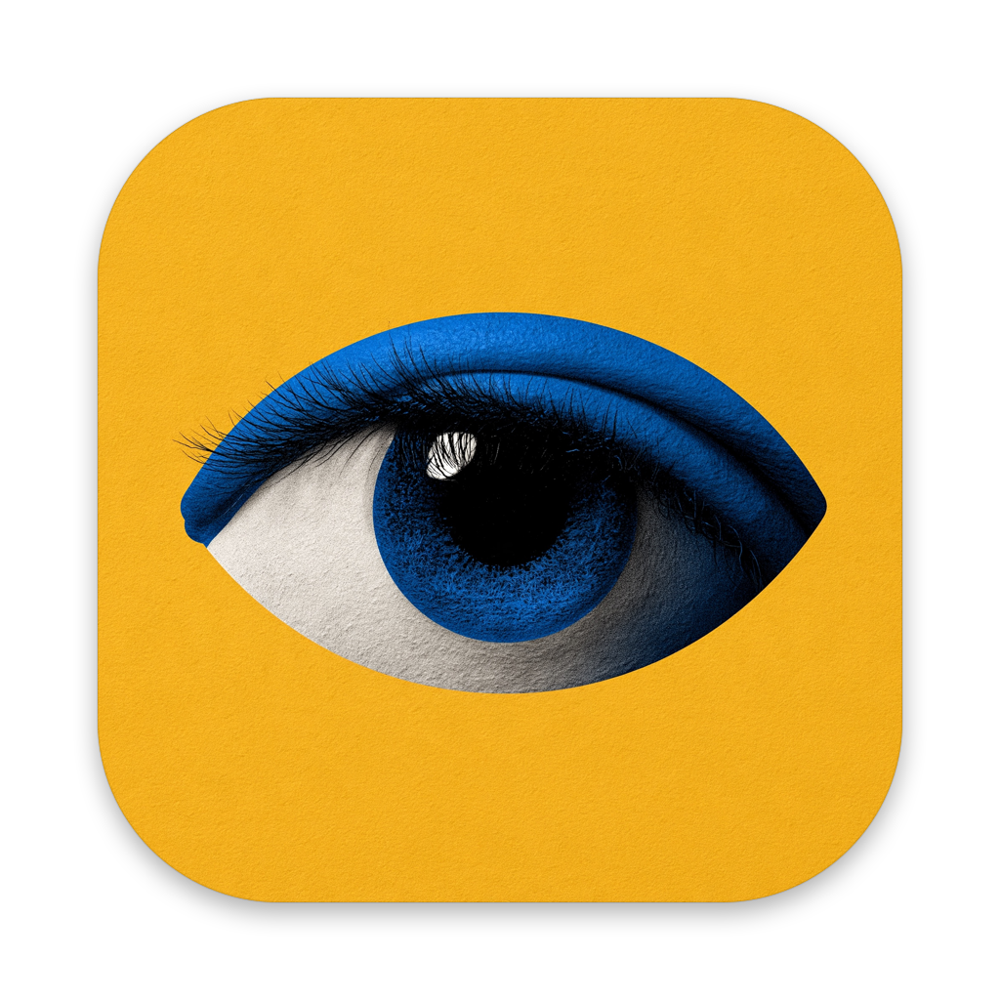

<p align="center"></p>

# Wink

**An agentic-first web browser for macOS, built on Chromium.**

Wink is a native macOS browser (AppKit + SwiftUI) on the Chromium engine. Agents are first-class: Wink exposes the browser to any agent through the Model Context Protocol, and Winky, its assistant, answers and acts right on the page you're on, using Claude or your local Claude Code. It is private by default: no telemetry, tracker blocking, HTTPS upgrades, and an explicit consent model for everything an agent touches.

- **Native and fast.** The UI is native AppKit + SwiftUI, with no web-based browser chrome. It is ready in ~265 ms, keeps live tabs in place so switching is instant, and puts idle tabs to sleep (5 open tabs: 858 MB → 421 MB).
- **Agentic.** A built-in MCP server lets Claude Code, Claude Desktop, or any MCP client drive Wink, and Winky runs on Claude (API) or your local Claude Code CLI, from a prompt bar that floats over the page (⌘J).
  - **Few round trips.** Every action reports only what it changed, refs survive re-renders, and `find`, `fill_form` and `batch` handle repetitive work, so agents need far fewer turns than with Playwright ([comparison](https://wink.minnebo.ai/vs-playwright)).
  - **Built for web developers.** Network requests in full, mocks and offline mode, cookies and storage, JavaScript on localhost, phone sizes and dark mode, dialogs, uploads, drag and drop, PDFs and video. `export_test` turns what an agent did into a Playwright test that runs in Chromium, Firefox and WebKit.
  - **Visible.** A soft aurora rims the page, Wink's eye glides to each step and winks on every click, and an activity pill offers Pause and Stop.
  - **Guarded.** Wink asks before an agent sends, buys, deletes or connects; checks in after a burst of such actions; and pauses the agent the moment you click into its page.
- **Private.** It blocks 93k tracker and ad domains, upgrades to HTTPS, blocks third-party cookies, and sends Global Privacy Control. WebRTC doesn't leak your local IP. The Chromium sandbox is on, and no debugging port is ever opened. There is no account; a daily update check carries anonymous usage counts you can switch off ([details](docs/PRIVACY.md#updates-and-anonymous-counts)).
- **Personal.** Winky, Wink's assistant, welcomes you on first launch and sets up a local profile (your name and photo, kept on your Mac).
- **Easy to switch.** File › Import from Another Browser… brings your logins, history and bookmarks over from Chrome, Arc, Brave, Edge or Vivaldi, on your Mac only, leaving tracker cookies behind.

## Build and run

Requirements: macOS 14+, Command Line Tools or Xcode, CMake ≥ 3.29, Ninja (`brew install cmake ninja`).

```sh
make bootstrap   # download the pinned Chromium engine (CEF 156, checksum-verified)
make             # build build/Wink.app
make run         # launch (or `make run-debug` to see logs in the terminal)
make test        # unit tests for the engine's privacy core
```

The first build compiles CEF's C++ wrapper (~2 min on an M3); incremental builds take seconds.

## Use it

| | |
|---|---|
| ⌘T | Command bar: open, search, switch tab, or ask Wink (⌘↩) |
| ⌘L | Edit the current address |
| ⌘J | Ask Winky, in a prompt bar over the page |
| ⌥⌘J | Winky's sidebar, for longer conversations |
| ⌘S | Toggle sidebar (hover the left edge to peek) |
| ⇧⌘. | Stop all agents |
| ⇧⌘E | Share the current tab with agents |
| ⌘1…⌘9, ⌃Tab | Switch tabs |
| ⇧⌘T | Reopen closed tab |
| ⌘F, ⌘G | Find in page |
| ⌥⌘I | Developer tools |

### Claude Code

Install Wink in Applications and open it once: if Claude Code is on your Mac, Wink adds itself to Claude Code's MCP servers (user scope), so every Claude Code session can browse with it. Nothing opens until an agent actually uses a tool; then Wink opens by itself. Turn it off in **Settings › Agents** (or with `claude mcp remove wink`) and Wink won't add itself again. To add it by hand:

```sh
claude mcp add --scope user wink -- "/Applications/Wink.app/Contents/MacOS/wink-mcp"
```

Then ask Claude Code things like *"open localhost:3000 in Wink, click through the signup flow and tell me what errors show up in the console."* The first time, Wink asks whether to let Claude Code browse.

## Documentation

- [Architecture](docs/ARCHITECTURE.md): how Wink is built on Chromium and how the pieces fit
- [Agents](docs/AGENTS.md): the MCP tools, what you see, guardrails, the consent model, and Winky
- [Privacy](docs/PRIVACY.md): what Wink protects against and how
- [Releasing](docs/RELEASING.md): signing, notarization and the DMG

## Release

`scripts/release.sh` builds a Developer ID–signed, notarized and stapled `Wink-<version>.dmg` (see [Releasing](docs/RELEASING.md)).

- **Downloads:** public, on [wink-browser/releases](https://github.com/wink-browser/releases).
- **Website:** [wink.minnebo.ai](https://wink.minnebo.ai).

## Contributing

Issues and pull requests are welcome; start with [CONTRIBUTING.md](CONTRIBUTING.md). Report security problems privately, as [SECURITY.md](SECURITY.md) describes. Everyone taking part follows the [Code of Conduct](CODE_OF_CONDUCT.md).

## License

Wink is open source under the [Apache License 2.0](LICENSE). The Wink name, logo and the Winky portrait are not; see [TRADEMARKS.md](TRADEMARKS.md). Third-party notices are in [NOTICE](NOTICE).

## Status

Wink is an early build. See the roadmap in [Architecture](docs/ARCHITECTURE.md#roadmap). Video plays in H.264, AAC and HEVC (the engine is built with Chromium's proprietary codecs). DRM-protected streaming (Netflix, Spotify, Disney+) needs Widevine, which isn't in yet.
